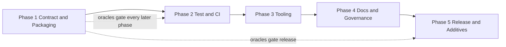

# GraphChem: API-stable modernization of graph-based fuel property prediction

**Design Document — v0.1**
**Status:** Approved (2026-07-22)
**Package:** `graphchem` (PyPI / import name unchanged)
**License:** MIT (unchanged)
**Current release baseline:** `2.3.3` (2025-02 tip)
**Modernization release tag:** `2.3.4` (Phase 5; large unfinished additives may defer to `2.4.0`)

---

## 1. Summary

GraphChem is an open-source Python package for constructing graph neural network models that predict fuel properties from molecular structure. It provides SMILES-to-graph encoding (RDKit), PyTorch Geometric dataset wrappers, a molecular GCN (`MoleculeGCN`), and bundled property datasets (cetane number, lower heating value, research/motor octane number, yield sooting index).

The package is published on PyPI and documented on Read the Docs, but repository engineering has lagged: hard-pinned and deprecated dependencies (`rdkit-pypi`), thin tests without coverage gates, single-Python push-only CI, missing governance files, and limited scientific-software maturity signals.

The present work modernizes packaging, testing, CI, tooling, documentation, governance, and selected internals **without changing the public API contract**. Downstream code that imports the current callables and classes must continue to work with identical signatures, default behaviors, return shapes, serialization formats, and primary exception types within the `2.3.x` / `2.4.x` compatibility series.

This document is the design source of truth for a five-phase modernization program (**Phases 1–5**).

---

## 2. Motivation and problem statement

### 2.1 Current landscape

Graph neural networks over molecular graphs remain a practical path for fuel-property screening when SMILES corpora and property labels are available. GraphChem packages a focused train/predict path: encode SMILES → build PyG graphs → train `MoleculeGCN` → evaluate. Empirically, nineteen unit tests pass under a constrained environment, but several engineering gaps limit safe maintenance:

| Area | Current state (baseline `2.3.3`) |
|------|----------------------------------|
| Public API | ~15 symbols across `data`, `datasets`, `nn`, `preprocessing` — stable in practice |
| Layout | Flat `graphchem/` package (~820 LOC); not `src/` |
| Tests | 19 tests in 4 files; no coverage tooling or floor; no end-to-end pipeline test |
| Versioning | `importlib.metadata.version("graphchem")` — fails if package is not installed |
| Dependencies | Exact pins; deprecated `rdkit-pypi==2022.9.5`; `numpy` used but undeclared |
| Tooling | No `[dev]`/`[docs]`/`[examples]` extras; no ruff/pre-commit/mypy |
| CI | Single Python 3.11 job on `push` only; Actions `@v3`; no PR gate |
| Docs | MkDocs + mkdocstrings stubs; 8 example notebooks not in docs nav; no quickstart page |
| Governance | MIT `LICENSE` only; no CHANGELOG, CITATION.cff, CONTRIBUTING, SECURITY, CoC, templates |
| Data | Bundled CSVs (~2k rows) without dataset cards / provenance docs |
| Publishing | Release-triggered PyPI upload (token-based workflow) |

### 2.2 Why now

1. Downstream notebooks and integrators rely on import and featurizer stability; modernization debt raises the cost of every dependency bump.
2. `rdkit-pypi` is deprecated; the official `rdkit` package is the supported distribution path.
3. Exact pins on `torch` / `torch-geometric` complicate installs across platforms and block security updates.
4. Featurizer string formats (`atom_to_str` / `bond_to_str`) are RDKit-version-sensitive; upgrades without golden oracles risk silent vocab breaks and unreadable saved encoders.
5. A compatibility-preserving modernization is cheaper than an API rewrite that would strand example notebooks and any published workflows citing the current API.

### 2.3 Non-goals

The following are explicitly out of scope for Phases 1–5:

1. **Changing the public API** — no renamed exports, no required new arguments, no change to return container types or primary exception types for documented failure modes.
2. **Changing featurizer token strings** in a way that invalidates existing pickled encoders (unless a dual-load migration is explicitly approved and versioned).
3. **Replacing `MoleculeGCN`** with a different default architecture (GIN, Transformer, etc.) as the primary model.
4. **Mandatory CLI, GUI, or web service** as the primary interface (optional CLI may appear in Phase 5 as additive).
5. **Changing bundled property dataset numeric contents** without an explicit, versioned data revision and migration note.
6. **JOSS submission** as a required deliverable of Phases 1–5 (citation metadata and docs alignment are in scope; a new paper is not).
7. **GPU-specific training frameworks** or distributed training APIs.

---

## 3. What's genuinely new

This program is an engineering modernization of an existing scientific package, not a new property-prediction algorithm. Differentiation relative to a rewrite is:

1. **Frozen-contract modernization** — tooling, tests, CI, docs, and internals improve while submodule imports and documented behaviors remain drop-in compatible.
2. **Featurizer and encoder oracles as release gates** — golden SMILES encodings and pickled-encoder round-trips must stay green across RDKit and internal changes.
3. **Dependency ranges with a CI matrix** — move from brittle exact pins to supported ranges while proving behavior on multiple Python versions.
4. **Production packaging baseline** — modern extras, coverage floor, multi-version CI, lint/format gates, governance files, and a safer publish path.
5. **Explicit stability policy** — additive optional kwargs and clearer errors are allowed; behavior changes that alter encodings, predictions, or dataset contents require a documented version bump strategy.

---

## 4. Goals

Numbered goals are testable exit criteria for the modernization program.

1. **G1 — API contract suite.** CI fails if public signatures change, if golden featurizer/encoder oracles regress, or if the end-to-end SMILES → GCN forward path breaks.
2. **G2 — Packaging and dependencies.** `numpy` declared; `rdkit-pypi` replaced by `rdkit`; compatible version ranges for torch / torch-geometric / rdkit where safe; `[dev]`, `[docs]`, `[examples]` extras; `license` metadata; `__version__` works in editable and non-installed contexts with a documented fallback.
3. **G3 — Tooling and quality gates.** ruff lint/format, pytest-cov with a documented coverage floor, and pre-commit are enforced in CI.
4. **G4 — CI matrix.** Push/PR CI runs lint + tests on Python 3.10–3.13 (when wheels allow); coverage reported; Actions kept current; Dependabot (or equivalent) enabled.
5. **G5 — Test depth.** Integration/e2e coverage of encode → graph → model; invalid SMILES paths; batched GCN forward; bond ring-size path; coverage floor **≥90%**.
6. **G6 — Documentation.** Sphinx + Furo site with install + quickstart + API autodoc builds with warnings as errors; notebooks remain valid examples and are linked from tutorials; README install/contact accuracy improved.
7. **G7 — Governance and citation.** CONTRIBUTING, CHANGELOG, CITATION.cff, SECURITY, CODE_OF_CONDUCT, and issue/PR templates present.
8. **G8 — Data provenance.** Dataset cards for bundled CSVs (scope, units, provenance, license notes).
9. **G9 — Release path.** Compatibility release `2.3.4` ships only after Phases 1–5 gates for the modernization program pass; prefer trusted publishing (OIDC) when credentials allow.
10. **G10 — Additive extensions (Phase 5).** Optional JSON encoder format with pickle fallback, optional pretrained weights, optional CLI, and/or benchmark harness — each additive and behind defaults that preserve today’s behavior.

---

## 5. Target users and use cases

| User | Use case |
|------|----------|
| Combustion / biofuel researcher | Train or evaluate graph models for CN, LHV, RON/MON, YSI |
| Pipeline author | Embed `MoleculeEncoder` + `MoleculeGCN` in an existing PyTorch Geometric workflow |
| Library integrator | Depend on `graphchem` from PyPI without adapting to API churn |
| Educator / student | Follow example notebooks for property-prediction tutorials |
| Maintainer / contributor | Run lint/tests locally and in CI; cut safe patch/minor releases |

**Primary constraint:** integrators and existing notebooks must not need code changes when upgrading within the compatibility series.

---

## 6. Related work

| Project | What it does | Status | Gap this package fills |
|---------|--------------|--------|------------------------|
| [PyTorch Geometric](https://pytorch-geometric.readthedocs.io/) | Graph ML primitives and models | Active | General toolkit; not fuel-property datasets + SMILES encoder + ready GCN path |
| [Chemprop](https://chemprop.readthedocs.io/) | Message-passing NNs for molecular property prediction | Active | Different default architecture and CLI-first workflow; not GraphChem’s encoder/`MoleculeGCN` API |
| [DeepChem](https://deepchem.io/) | Broad cheminformatics / ML toolkit | Active | Broad scope; not a small fuel-focused graph package with bundled combustion datasets |
| [DGL-LifeSci](https://lifesci.dgl.ai/) | Graph models for life sciences | Active | Different framework (DGL); not PyG + GraphChem API |
| [RDKit](https://www.rdkit.org/) | Cheminformatics toolkit | Ecosystem standard | GraphChem consumes RDKit for featurization; RDKit alone does not ship the GCN + fuel datasets |

**Primary literature / methods to cite where encodings or models are discussed (docstrings, docs, tests as applicable):**

- RDKit documentation for molecular graph perception from SMILES.
- PyTorch Geometric convolution / pooling APIs used by `MoleculeGCN` (`GeneralConv`, `EdgeConv`, `global_add_pool`).
- Fuel-property dataset sources underlying bundled CSVs — to be recorded in Phase 4 dataset cards (open question until provenance is confirmed).
- Comparison notebooks referencing Schweidtmann et al. data — retain citation notes when documenting benchmarks.

---

## 7. Architecture overview

GraphChem remains a **layered scientific ML package**. Modernization may refine helpers and packaging layout but must preserve the import surface.

```text
+------------------------------------------------------------------+
|  Public API (submodule exports)                                  |
|  graphchem.__version__                                           |
|  graphchem.data: MoleculeGraph, MoleculeDataset                  |
|  graphchem.datasets: load_cn, load_lhv, load_mon, load_ron,     |
|                      load_ysi                                    |
|  graphchem.nn: MoleculeGCN                                       |
|  graphchem.preprocessing: get_ring_size, atom_to_str,            |
|      bond_to_str, Tokenizer, MoleculeEncoder, load_encoder       |
+--------------------------------+---------------------------------+
                                 |
         +-----------------------+-----------------------+
         v                       v                       v
+----------------+     +------------------+     +------------------+
| L3 Model       |     | L2 Graph data    |     | L2 Datasets      |
| nn/gcn.py      |---->| data/structs.py  |     | datasets/sets.py |
| MoleculeGCN    |     | MoleculeGraph    |     | load_* + CSV     |
+--------+-------+     | MoleculeDataset  |     +--------+---------+
         |             +--------+---------+              |
         |                      ^                        |
         |                      |                        |
         +----------------------+------------------------+
                                |
                       +--------v---------+
                       | L1 Encoding      |
                       | preprocessing/   |
                       | features.py      |
                       +--------+---------+
                                |
                       +--------v---------+
                       | L0 Deps + data   |
                       | rdkit, numpy,    |
                       | torch, torch_    |
                       | geometric;       |
                       | static/*.csv     |
                       +------------------+
```

**Dependency rule:** Higher layers may import lower layers; L1 must not import L3; dataset loaders must not import `MoleculeGCN`. New helpers stay private (`_`-prefixed) unless deliberately re-exported.

**Layout decision (approved):** Migrate to `src/graphchem/` in **Phase 1** after the contract suite lands, keeping `import graphchem` unchanged. Package data (`datasets/static/*.csv`) must continue to ship in sdists and wheels.

---

## 8. Core data model and public API

### 8.1 Frozen public surface

```python
from graphchem import __version__

from graphchem.data import MoleculeGraph, MoleculeDataset

from graphchem.datasets import (
    load_cn, load_lhv, load_mon, load_ron, load_ysi,
)

from graphchem.nn import MoleculeGCN

from graphchem.preprocessing import (
    get_ring_size,
    atom_to_str,
    bond_to_str,
    Tokenizer,
    MoleculeEncoder,
    load_encoder,
)
```

Add `__all__` in each submodule during Phase 1 to make the freeze explicit. Do **not** require top-level re-exports of submodule symbols in `2.3.4` (additive convenience re-exports are Phase 5 optional / may land in `2.4.0`).

### 8.2 Behavioral contracts to preserve

| Contract | Detail |
|----------|--------|
| Bond duplication | `MoleculeEncoder.encode()` produces `2 × num_bonds` bond features (each bond from both atom endpoints) |
| Target shape | `MoleculeGraph` enforces `y.shape[0] == 1` |
| Featurizer strings | `atom_to_str` / `bond_to_str` tuple-string format drives tokenizer vocabularies |
| Encoder persistence | `MoleculeEncoder.save` / `load_encoder` remain pickle-compatible for existing files |
| GCN outputs | `MoleculeGCN.forward(data)` returns `(out, out_atom, out_bond)` |
| `n_readout=0` | Returns pooled embeddings without readout MLP |
| Dataset loaders | `load_*()` → `Tuple[List[str], torch.Tensor]` with stable column semantics |
| Invalid SMILES | `MoleculeEncoder` raises `ValueError` on unparsable SMILES |

### 8.3 Signature contracts (preserve)

Keyword names and defaults must remain compatible; additive optional kwargs only.

```python
MoleculeGraph(atom_attr, bond_attr, connectivity, target=None)
MoleculeDataset(graphs)

MoleculeGCN(
    atom_vocab_size: int,
    bond_vocab_size: int,
    output_dim: int,  # type hint may be corrected to Optional[int] without behavior change
    embedding_dim: int | None = 128,
    n_messages: int | None = 2,
    n_readout: int | None = 2,
    readout_dim: int | None = 64,
    p_dropout: float | None = 0.0,
    aggr: str | None = "add",
    act_fn: callable | None = F.softplus,
)

MoleculeEncoder(smiles: list[str])
MoleculeEncoder.encode(smiles: str) -> tuple[Tensor, Tensor, Tensor]
MoleculeEncoder.encode_many(...)
MoleculeEncoder.save(filename)
load_encoder(filename)

Tokenizer.__call__(...)
Tokenizer.train / .unknown / .vocab_size

get_ring_size(obj, max_size=12)
atom_to_str(atom)
bond_to_str(bond)

load_cn(); load_lhv(); load_mon(); load_ron(); load_ysi()
```

### 8.4 Stability policy

- **Allowed without major bump:** bug fixes that restore documented behavior; additive optional kwargs with defaults matching today; clearer error messages of the same exception type; dependency range widening proven by oracles.
- **Requires minor bump (`2.4.x`):** new public symbols; new optional serialization formats with pickle fallback; new CLI entry points (typical home for large additives deferred from the `2.3.4` modernization release).
- **Requires major bump (`3.0.0`):** featurizer string schema changes that break existing encoders; removal of pickle load; changes to `forward` return arity/shapes; dataset content revisions that change labels for the same SMILES.

---

## 9. Module design

### 9.1 `graphchem.preprocessing` (`features.py`)

**Purpose:** SMILES → atom/bond tokens → tensors + connectivity.
**Preserve:** string featurization semantics; bond duplication; pickle save/load; `ValueError` on bad SMILES.
**Internal improvements:** migrate deprecated RDKit valence APIs behind a compatibility helper; stabilize tests to assert parsed properties (not brittle `str(enum)` dumps) while golden oracles lock encoding outputs; optional JSON vocab format in Phase 5 with pickle fallback.

### 9.2 `graphchem.data` (`structs.py`)

**Purpose:** PyG `Data` / `Dataset` wrappers.
**Preserve:** constructor arguments; target reshaping rules; `MoleculeDataset` length/get semantics.
**Internal improvements:** type-hint accuracy; no public API rename.

### 9.3 `graphchem.datasets` (`sets.py`)

**Purpose:** Load bundled fuel-property CSVs.
**Preserve:** five `load_*` callables and return types.
**Internal improvements:** remove redundant `close()` after `with`; dataset cards in Phase 4; do not alter CSV contents in this program without an explicit data revision.

### 9.4 `graphchem.nn` (`gcn.py`)

**Purpose:** Molecular GCN for property prediction.
**Preserve:** constructor defaults; `forward` triple return; `n_readout=0` behavior; aggregation/activation hooks.
**Internal improvements:** correct `output_dim` typing vs `None` usage; batched-forward tests; no architecture swap.

### 9.5 `graphchem.version` / `__init__.py`

**Purpose:** `__version__` export.
**Change:** keep `importlib.metadata` primary path; add safe fallback for editable/uninstalled trees so imports used by tests do not require a prior `pip install` in every workflow.

---

## 10. Dependencies and ecosystem integration

| Kind | Decision |
|------|----------|
| Runtime | `rdkit` (replace `rdkit-pypi`), `numpy` (declare), `torch`, `torch-geometric` |
| Pinning strategy | Supported ranges after oracle-backed upgrades (e.g. `torch>=2.5,<3`, `torch-geometric>=2.6,<3`, `rdkit>=2022.9.5` with CI-proven upper bounds); keep a CI constraint file if needed for reproducibility |
| Optional extras | `[dev]` — pytest, pytest-cov, ruff, pre-commit, build; `[docs]` — Sphinx, Furo, autodoc/napoleon/intersphinx/sphinx-copybutton stack; `[examples]` — scikit-learn, matplotlib, jupyter |
| System notes | Document platform-specific torch / PyG install links in README (unchanged intent) |
| Notebook-only deps | Must not become hard runtime deps |

No replacement of RDKit or PyG as core engines in Phases 1–5.

---

## 11. Validation strategy

### 11.1 Contract suite (load-bearing; Phase 1 gate)

| Test class | What | Pass criteria |
|------------|------|---------------|
| Signature locks | `inspect.signature` on public callables/classes | Parameter names + defaults stable |
| Import smoke | All frozen exports importable | No `PackageNotFoundError` in supported install modes |
| Golden encodings | Fixed SMILES set → atom/bond/connectivity tensors | Exact integer tensors / hashes vs fixtures |
| Encoder round-trip | `save` / `load_encoder` pickle | Identical `vocab_sizes` and encodings |
| E2E smoke | `load_*` sample → encode → `MoleculeGraph` → `MoleculeGCN` → loss backward | Completes without error; finite loss |
| Error paths | Invalid SMILES | `ValueError` |

Store fixtures under `tests/fixtures/` with a short README stating they lock **current GraphChem + declared RDKit** behavior for regression, not independent literature tables (unless later expanded).

### 11.2 Expanded tests (Phase 2)

- Batched `DataLoader` forward through `MoleculeGCN`
- `aggr` variants; `n_readout=0`; activation callables used in current tests
- Bond-path `get_ring_size`
- Dataset shape/dtype sanity; optional NaN/duplicate checks (non-breaking)
- Reduce brittleness of `atom_to_str` / `bond_to_str` unit tests (property-level asserts + golden oracles)

### 11.3 Coverage

- Phase 2 onward: **≥90%** line coverage on package modules as the CI floor.
- Raise toward **≥90%** once e2e and error paths land, if stable.
- Bundled CSV contents are out of coverage scope.

### 11.4 Numerical tolerances

- Encoding oracles: exact integer equality.
- Model smoke tests: finite tensors; optional seeded weight-init checks with `torch.manual_seed`.
- Benchmark regression (Phase 5): tolerance bands against comparison-notebook metrics, documented per metric.

### 11.5 Docs / notebooks

- Sphinx + Furo under `docs/source/`; CI builds with `sphinx-build -W` after Phase 4 docs work.
- Keep eight example notebooks working without API changes; optional `nbmake` on one canonical notebook in Phase 2/4.
- Add Sphinx `quickstart` (and tutorials index linking `examples/`) derived from a slimmed notebook.
- Retire MkDocs stubs (`mkdocs.yml`, `docs/api_*`, Material config) as part of the Sphinx migration; update `.readthedocs.yaml` for Sphinx.

### 11.6 Local verification and CI gates

**Local-first (Phases 1–5):** All phase work must be completed and verified **locally** before any push intended for release. Local commands are the definition of done for each phase exit (lint, tests + coverage, docs build once gated, `python -m build` when packaging is in scope).

**Remote CI:** Repository CI (lint + test matrix + docs when present) runs on pull requests and pushes. That run is a confirmation gate after local verification, not a substitute for it.

---

## 12. Open-source packaging

| Concern | Decision |
|---------|----------|
| Build backend | setuptools via `pyproject.toml` (current); keep unless a zero-risk hatchling migration is approved later |
| Layout | `src/graphchem/` in Phase 1 (required before the `2.3.4` release) |
| Python versions | `requires-python = ">=3.10"`; CI on 3.10–3.13 |
| License | MIT; add PEP 621 `license` field; fix README badge path (`LICENSE` vs `LICENSE.txt`) |
| Docs | Sphinx + Furo under `docs/source/`; Read the Docs via updated `.readthedocs.yaml`; retire MkDocs |
| CI | PR + push; lint + pytest matrix; docs build job when ready |
| Release | Tag/release-triggered publish; prefer PyPI trusted publishing (OIDC) |
| Governance | CONTRIBUTING, CODE_OF_CONDUCT, CHANGELOG, SECURITY, CITATION.cff, issue/PR templates |
| Citation | `CITATION.cff` pointing at the GitHub repo; related references for datasets/methods as known |
| Supply chain | Current Actions majors or SHA pins + Dependabot; no secrets in repo |
| Package data | Continue shipping `graphchem/datasets/static/*.csv` via `MANIFEST.in` / package data |

---

## 13. Roadmap (Phases 1–5)

Phases map to implementation milestones. Phases 1–4 stay on tip **`2.3.3`** (no interim packaging bump required). The sole PyPI modernization tag for this program is **`2.3.4`**, cut at the end of **Phase 5** after Phases 1–4 exit. Large Phase 5 additives that are not ready may defer to a follow-up **`2.4.0`**; they must not block `2.3.4` if Phases 1–4 and the release path (G9) are complete. **All phase work must be done and verified locally** (§11.6).

| Phase | Theme | Primary goals | Suggested version |
|-------|-------|---------------|-------------------|
| **1** | Contract freeze + packaging / deps | G1, G2 | Tip **`2.3.3`** (no required PyPI tag) |
| **2** | Test & CI maturity | G4, G5 (partial G3) | Tip **`2.3.3`** |
| **3** | Tooling (lint/format/types) | G3 | Tip **`2.3.3`** |
| **4** | Docs, governance, scientific maturity | G6, G7, G8 | Tip **`2.3.3`** |
| **5** | Additive features + compatibility release | G9, G10 | Tag and publish **`2.3.4`** (defer unfinished large additives to **`2.4.0`**) |

### 13.1 Phase 1 — Contract freeze + packaging / dependency hygiene

**Intent:** Make unsafe refactors detectable, then migrate packaging off deprecated pins without changing the public API.

Deliverables:

1. Document the frozen API (this design §8); add submodule `__all__`; optional short `API_STABILITY.md` (may migrate into docs in Phase 4).
2. Add contract suite: signature locks, golden encodings, encoder pickle round-trip, e2e smoke, invalid SMILES.
3. Declare `numpy`; add `license = "MIT"`; expand classifiers as versions are proven. Leave packaging version at **`2.3.3`** until Phase 5.
4. Replace `rdkit-pypi` with `rdkit`; introduce compatible ranges for torch / torch-geometric after oracles pass.
5. Add `[project.optional-dependencies]` for `dev`, `docs`, `examples`.
6. Fix `__version__` fallback for non-installed / editable workflows.
7. Migrate to `src/graphchem/`; verify wheel contains static CSVs.
8. Migrate deprecated RDKit valence APIs behind an internal compatibility helper (behavior unchanged).

**Exit:** Local `pytest` green with contract suite; `pip install -e ".[dev]"` works; `rdkit` (not `rdkit-pypi`) resolves; golden encodings unchanged vs fixtures captured at Phase 1 start.

### 13.2 Phase 2 — Test & CI maturity

**Intent:** Enforce trust on every PR and deepen behavioral coverage.

Deliverables:

1. CI on `pull_request` + `push`; Python 3.10–3.13 matrix (skip/mark if a torch wheel is missing).
2. Coverage reporting with **≥90%** fail-under on package modules.
3. Expand tests: batched GCN, `aggr` variants, bond ring-size, dataset sanity, stabilize brittle string unit tests.
4. Bump Actions majors (or SHA-pin); add Dependabot for Actions and pip.
5. Optional: `nbmake` (or equivalent) on one canonical example notebook.

**Exit:** Local pytest+cov ≥90%; workflow files correct for PR/push matrix; contract suite remains green.

### 13.3 Phase 3 — Tooling without behavior change

**Intent:** Bring contributor ergonomics to current scientific Python norms without logic rewrites.

Deliverables:

1. ruff check + format configuration; CI lint job.
2. `.pre-commit-config.yaml` with ruff (and optional mypy later).
3. Partial typing cleanup (`output_dim`, callable aliases); add `py.typed` when hints are honest enough.
4. Mechanical style-only cleanups (e.g. old-style `class X(object)`); no featurizer/string changes.

**Exit:** Local ruff (+ pre-commit) pass; CI lint green; oracles unchanged.

### 13.4 Phase 4 — Docs, governance, and scientific maturity

**Intent:** Make the project citeable, approachable, and maintainable.

Deliverables:

1. CHANGELOG (Keep a Changelog) starting from `2.3.3` baseline and preparing the `2.3.4` modernization release notes.
2. CITATION.cff; CONTRIBUTING; CODE_OF_CONDUCT; SECURITY; issue/PR templates.
3. Migrate docs to **Sphinx + Furo** under `docs/source/` (install, quickstart, API autodoc, tutorials linking `examples/`); update `.readthedocs.yaml`; remove MkDocs config and stub pages.
4. Dataset cards for bundled CSVs (scope, units, provenance, license notes) — Sphinx data page and/or per-dataset cards.
5. Docs build verification in CI: `sphinx-build -W -b html docs/source docs/_build/html`.
6. Fix README badge/contact accuracy; remove stale CI badges if any.
7. Reproducibility notes for examples (torch/numpy seeds; optional `environment.yml`).

**Exit:** Governance checklist complete; `sphinx-build -W` clean; dataset provenance documented at a maintainable minimum.

### 13.5 Phase 5 — Additive features + compatibility release (`2.3.4`)

**Intent:** Ship the completed modernization to PyPI as **`2.3.4`** and optionally land additive capabilities that do not break defaults.

Deliverables:

1. Confirm Phases 1–4 are **locally verified** (lint, tests + coverage, Sphinx `-W`, build) per §11.6.
2. Refresh publish workflow (prefer trusted publishing / OIDC if credentials allow; otherwise document token path).
3. Bump packaging version from **`2.3.3` → `2.3.4`**, finalize CHANGELOG, tag, and publish after local verification (and after CI is green when that push is used).
4. Additive options (any subset; each behind compatibility defaults):
   - JSON/msgpack encoder serialization with `load_encoder` pickle fallback
   - Optional pretrained model weights (download or package-data; documented)
   - Optional CLI entry points for encode/train/predict
   - Benchmark harness reproducing comparison-notebook metrics within tolerance
5. If additive work is large, ship **`2.3.4`** with Phases 1–4 + release path complete and land unfinished Phase 5 items in **`2.4.0`**.

**Exit (`2.3.4`):** Phases 1–5 program done and verified locally (with any deferred additives explicitly listed for `2.4.0`); tip was **`2.3.3`** through Phase 4; PyPI `2.3.4` artifact installable; contract suite passes from a clean venv.



---

## 14. Open questions

### 14.1 Open (require decision during implementation)

| # | Question | Options | Recommendation |
|---|----------|---------|----------------|
| Q3 | Coverage floor | 80% vs 90% at Phase 2 | **Decided: 90%** at T2.4 (stable suite already ~95%) |
| Q4 | Phase 5 additive scope in `2.3.4` vs `2.4.0` | Bundle small additives vs defer all | **Decided:** defer JSON encoder, CLI, pretrained weights, and benchmark harness to **`2.4.0`**; ship `2.3.4` as modernization-only |
| Q5 | Dataset provenance sources for CN/LHV/RON/MON/YSI | Confirm literature / lab sources for cards | **Deferred:** cards ship with Provenance = Unknown (T4.5); sources omitted until maintainer provides them |
| Q6 | Loosen torch pins how aggressively? | Narrow range vs wide | Wide enough for security patches; CI-proven upper bound |

### 14.2 Resolved (2026-07-22)

| # | Decision |
|---|----------|
| Q1 / R6 | Migrate to **`src/graphchem/`** in Phase 1 (after contract suite); required before `2.3.4` |
| Q2 / R7 | Docs stack is **Sphinx + Furo** (Phase 4); retire MkDocs |
| R1 | Public API remains submodule-based; no required top-level re-exports for `2.3.4` |
| R2 | Pickle encoder format remains supported through the compatibility series |
| R3 | Featurizer string schema is frozen; RDKit upgrades gated by golden encodings |
| R4 | Bundled CSV **contents** are frozen for this program unless a separate data revision is approved |
| R5 | Phases 1–4 tip stays **`2.3.3`**; sole modernization PyPI tag is **`2.3.4`** (end of Phase 5); unfinished large additives may follow in **`2.4.0`** |

---

## 15. Success criteria (program level)

The modernization is complete for `2.3.4` when:

1. All frozen imports and behavioral contracts in §8 still hold.
2. Goals G1–G9 are met (G10 as applicable).
3. CI gates PRs on a multi-version matrix with coverage and lint.
4. A clean-venv install from the release artifact runs the contract suite successfully.
5. Citation, changelog, and dataset provenance exist at a level appropriate for a maintained scientific package.

---

## 16. Hand-off

After this design is approved:

1. Break Phases 1–5 into an implementation blueprint (task-level checklist).
2. Execute tasks one phase at a time, keeping the contract suite green.
3. Do not start implementation in the same step as design approval unless explicitly requested.
